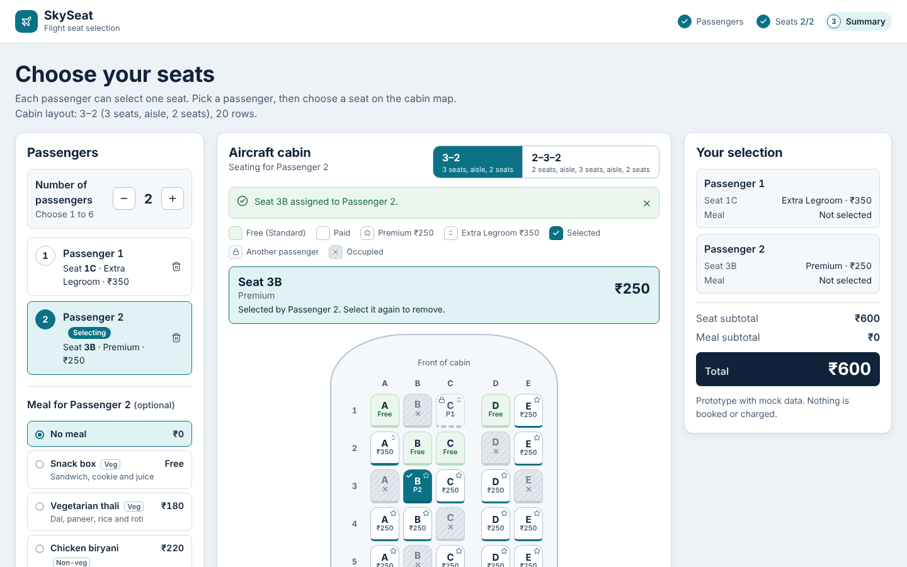
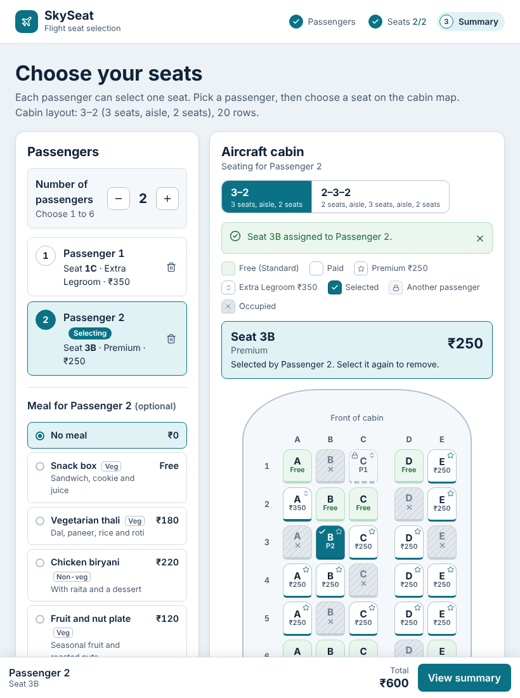
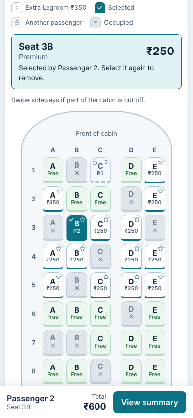

<<<<<<< HEAD
# SkySeat: Flight Seat Selection

A responsive flight seat selection and passenger management interface, built for the KPaisa frontend assessment. It uses mock data and local React state only. There is no backend, no database and no real booking or payment.

**Live demo:** _add your Vercel URL here after deploying_
**Repository:** _add your GitHub URL here_



| Tablet | Mobile |
| --- | --- |
|  |  |

## Features

- Choose 1 to 6 passengers and switch between them at any time.
- Two cabin layouts, switchable live: **3–2** (`A B C | D E`) and **2–3–2** (`A B | D E F | G H`), with row numbers, seat labels and visible aisles.
- Seat states that do not rely on colour alone: free, paid, selected, assigned to another passenger (shows the owner), and occupied. Each has its own icon or label and an accessible name such as `Seat 1C, Extra Legroom, ₹350, available`.
- Three seat categories: Standard (₹0), Premium (₹250) and Extra Legroom (₹350). Rows 1–2 of the 3–2 layout use the sample prices from the brief.
- Assign, change and remove a seat. Each passenger holds at most one seat, and each seat belongs to at most one passenger.
- Clear inline feedback for invalid actions (occupied seat, seat taken by another passenger, seats cleared on layout change). No browser alerts.
- Live pricing: seat subtotal, meal subtotal and grand total update instantly.
- **Bonus:** one meal per passenger, with free and paid options included in the total.
- Responsive: three columns on desktop, two on tablet, stacked on mobile. On mobile, a bottom bar keeps the active passenger and total visible, and the cabin scrolls sideways inside its own region when needed.
- Keyboard support: all controls are real buttons or radios, there is a visible focus ring, and arrow keys move between seats. Reduced-motion preferences are respected.

## Tech stack

React, Vite, JavaScript (ES modules), plain CSS, `lucide-react` icons. Tests use Vitest and Testing Library.

## Getting started

```bash
npm install
npm run dev       # http://localhost:5173
npm run build     # production build in dist/
npm run preview   # serve the production build locally
npm test          # unit and UI tests
```

## Project structure

```text
src/
├── components/   UI pieces (PassengerPanel, SeatMap, SeatButton, BookingSummary, ...)
├── data/         Mock data and configuration (seat rules, meals, passenger limits)
├── hooks/        useSeatSelection: the single owner of app state
├── utils/        Pure logic (assignment rules, pricing, layout generation, seat state)
├── styles/       Global tokens and per-area CSS
├── App.jsx
└── main.jsx
```

## State management

All state lives in one hook, `useSeatSelection`, and `App` passes it down as props.

| State | Purpose |
| --- | --- |
| `passengers` | `[{ id, name, seatId, mealId }]`. **This is the only record of who owns which seat.** |
| `activePassengerId` | The passenger currently choosing a seat. |
| `layout` | `"3-2"` or `"2-3-2"`. |
| `notice` | The current inline feedback message. |

Seats are static data (generated once per layout), so they are not state. Everything else is derived on each render: the seat owner lookup, totals and summary rows. Nothing is stored twice, so nothing can go stale.

## Seat assignment and duplicate prevention

The rules live in `src/utils/assignment.js` as pure functions that return the next passengers and a result message. The UI does not duplicate them.

When the active passenger selects a seat:

1. If the seat is pre-occupied, reject it with a message.
2. If another passenger already owns it, reject it and name the owner.
3. If the active passenger already owns it, release it (selecting your own seat again toggles it off).
4. Otherwise set the passenger's `seatId`. Their previous seat is released automatically because it is just the same field being overwritten.

Because ownership is a single field on the passenger, a passenger cannot hold two seats. Seat ownership is checked against all passengers before every assignment, so a seat cannot be held twice. Switching passengers only changes `activePassengerId`, so earlier assignments are never touched.

Occupied and locked seats use `aria-disabled` rather than `disabled`. They look unavailable and have no hover effect, but remain focusable and clickable so they can explain why they cannot be chosen.

**Reducing the passenger count** removes the extra passengers and releases their seats. If the active passenger is removed, the first passenger becomes active. A message lists what was removed.

## Pricing

Totals are derived, never stored (`src/utils/pricing.js`):

```text
seatTotal  = sum of price of each passenger's assigned seat
mealTotal  = sum of price of each passenger's chosen meal
grandTotal = seatTotal + mealTotal
```

Prices are shown in INR (`₹`, Indian digit grouping). Free seats show `Free`. Taxes, baggage and fees are out of scope.

## Layout switching

Layouts are metadata: an ordered list of seat groups per layout, with aisles between groups. One renderer draws both.

Switching layouts **keeps a passenger's seat only if the same seat ID exists in the new layout and is not pre-occupied there**. Otherwise that seat is cleared and a message says whose seat and why. A kept seat takes the price it has in the new layout. A passenger is never shown in a seat that does not exist in the active layout.

## Assumptions and known limitations

- Each layout has its own mock inventory, so the same seat ID (for example `1A`) can be a different seat in each. The occupied seats are fixed, not random.
- Mock data only. There is no persistence, so a refresh resets everything.
- Passenger names are fixed labels (`Passenger 1`, ...). Editing names was not part of the brief.
- Fonts load from Google Fonts. If they cannot load, system fonts are used.
- Not tested on real devices or screen readers beyond automated tests and browser checks at mobile, tablet and desktop widths.

=======
# flight-Service
>>>>>>> b489d2dfc232c916bdd9d01d9d3864dcfb424356
